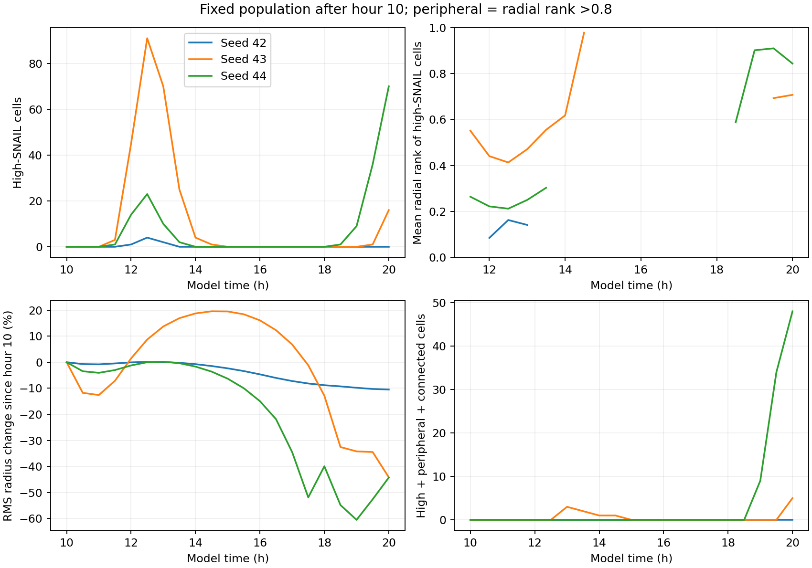
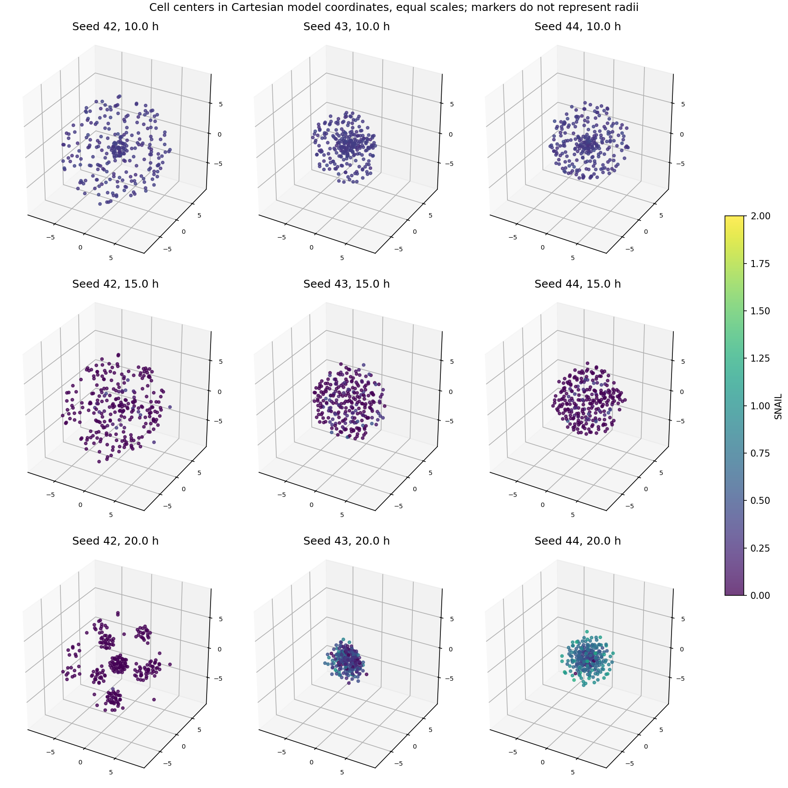
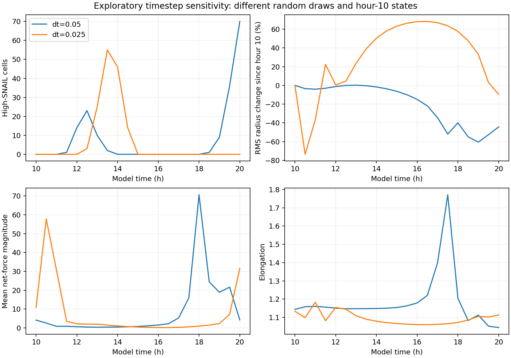

# E006: longer fixed-population observation

Date: 2026-11-06 (Europe/Berlin). Internal protocol written before runs;
this is not an externally preregistered study.

## Question

Does more regulatory and mechanical time allow localized peripheral activity
and sustained connected motion to emerge without continued population growth?

## Protocol

Repeat the E005 growth-off condition through 20 model hours, retaining normal
development before hour 10. Radius growth and division stop at hour 10;
protrusion, GRN, adhesion, repulsion and chemical updates remain active.
Seeds 42, 43 and 44; dt=0.05; snapshots every 0.5 h. No application model
source changes. These are artificial fixed-population runs, not an extension
of normal growing development beyond its cell limit.

Check exact agreement with E005 through the last shared nonterminal sample
(11.5 h); differences at its terminal 12 h sample may reflect floating-point
rounding of its final step. IDs and radii must stay fixed after hour 10.
Each run should reach hour 20 with 256 cells and 200 growth-arrest steps.

## Planned observations

- Cell count, high-SNAIL fraction (>0.8), RMS spread, elongation,
  proximity connectivity and chemical-grid excursions over time.
- Final and temporal position of high-SNAIL cells: radial rank and neighbor
  count, with global radial rank treated as a proxy rather than actual surface.
- Two-hour windows from hour 12 onward: cells that remain high-SNAIL,
  peripheral (radial rank >0.8) and proximity-connected (at least one neighbor)
  at all five half-hour observations. Count unique cells as well as overlapping
  windows, and describe their radial progress, path straightness and neighbor
  retention. This is a screening definition, not a branch detector.
- Repeat the peripheral cutoff at 0.7 and 0.9, and final connectivity at
  proximity factors 1.0, 1.25 and 1.5, to expose definition sensitivity.
- Inspect equal-scale cell-center plots before describing macroscopic shape.

Path straightness is net centroid-corrected displacement divided by the sum
of sampled displacement lengths over the two-hour window. An immobile cell
has undefined straightness, not perfect persistence. Neighbor retention is
the fraction of starting neighbors that are still neighbors at the endpoint;
it does not prove they were pulled as followers. Half-hour observations miss
finer turns and transient contact losses. No formal significance test.

Longer observation might produce peripheral activity, or demonstrate that
activation and rearrangement remain internal. A rounded distribution alone
cannot rule out all local protrusions; screening candidates alone cannot
establish sustained tissue branches. Any large field-boundary excursion
limits interpretation because field sampling clamps to its edge.

Commands (separate output folders preserve individual run provenance):

```powershell
rtk proxy python tools/branching_baseline.py --hours 20 --dt 0.05 --seeds 42 --sample-every 0.5 --growth-off-at 10 --output _branching_fixed20_seed42
rtk proxy python tools/branching_baseline.py --hours 20 --dt 0.05 --seeds 43 --sample-every 0.5 --growth-off-at 10 --output _branching_fixed20_seed43
rtk proxy python tools/branching_baseline.py --hours 20 --dt 0.05 --seeds 44 --sample-every 0.5 --growth-off-at 10 --output _branching_fixed20_seed44
```

## Added exploratory sensitivity check

During execution, seed 44 showed substantial shape and force-proxy changes
around hours 17-18. Add a dt=0.025 repeat of seed 44 through hour 20 to
check sensitivity before interpreting those changes. This addition follows
an observed result; it was not part of the initial protocol. A smaller dt
also changes random draws and early geometry, so this is NOT a controlled
numerical convergence test of an identical hour-10 state. Treat differences
as a warning about robustness, not proof of a specific numerical defect.

```powershell
rtk proxy python tools/branching_baseline.py --hours 20 --dt 0.025 --seeds 44 --sample-every 0.5 --growth-off-at 10 --output _branching_fixed20_seed44_dt0025
```

## Main-run results (dt=0.05)

All three seeds reached hour 20 with 256 cells, fixed IDs/radii after hour 10,
and 200 growth-arrest updates. All 72 shared nonterminal snapshots through
11.5 h match E005 exactly. At hour 12 the maximum positional difference from
E005 is 4.97e-14, consistent with terminal-step rounding. All stored arrays
are finite. No cell centers are outside the chemical field in ANY saved
observation in these runs; excursions between observations were not tested.

| Seed | High-SNAIL at 20 h | Mean radial rank of high cells | High + peripheral + connected at 20 h | RMS change, 10 to 20 h |
| --- | --- | --- | --- | --- |
| 42 | 0 | Undefined | 0 | -10.47% |
| 43 | 16 | 0.708 | 5 | -44.19% |
| 44 | 70 | 0.844 | 48 | -44.30% |

There is no monotonic increase in activation. Seed 43 has 91 high-SNAIL
cells at its sampled first peak, followed by near-disappearance and a later
return. Seed 44 also has an early pulse, a quiet period, and late activation.
Seed 42 has at most four high-SNAIL cells at any saved observation and none
by the final sample. A pulse/return description does not establish a stable
oscillation, its period or its biological origin.





The views show seed 42 separating into clusters; seeds 43 and 44 contract
into compact groups. No clear macroscopic branching is apparent in these
three views per seed. This cannot exclude every local or transient protrusion.
Final elongations are 1.100, 1.247 and 1.044, respectively; low elongation
alone would not exclude a symmetric branching network.

## Connectivity

At factor 1.25, final component counts are 22, 2 and 1; largest-component
fractions are 0.2148, 0.9961 and 1.0. Across factors 1.0, 1.25 and 1.5,
largest-component fractions stay the same in this dataset, although the
number of small components in seed 42 changes (24, 22 and 20).

An additional geometric check uses the mechanics interaction cutoff of 2.5
model units, independent of cell radii. Final component counts under that
cutoff are 19, 2 and 1, with the same largest-component fractions. Thus the
final seed-42 clusters are also separated in the instantaneous mechanics
interaction graph. This is stronger than the earlier threshold-sensitive
10-hour connectivity dip, but does not prove clusters stay disconnected
continuously or identify the mechanism causing separation.

## Persistence screening

Across two-hour windows starting from 12 through 18 h, NO cell meets all
three criteria at all five sampled observations: high SNAIL, radial rank
above 0.8, and at least one proximity neighbor. The count remains zero at
radial cutoffs 0.7 and 0.9. This does not demonstrate absence of branches:
the definition can exclude cells that move from the interior to the periphery,
and it does not measure tissue topology.

An exploratory follow-up drops only the peripheral requirement. Four unique
seed-43 cells sustain high SNAIL for a full window: three over 12-14 h and
one over 12.5-14.5 h. Their radial progress is 0.84-1.39 model units,
sampled path straightness 0.969-0.993, and endpoint neighbor retention
46-67%. Their minimum radial ranks are 0.381-0.662, explaining why they
fail the peripheral screen. These selected trajectories show that persistent
directed motion can occur, but do not establish causal leadership or follower
guidance. No seed-42 or seed-44 cell sustains high SNAIL for a full analyzed
two-hour window.

The late seed-44 activation begins near 18.5 h. At hour 20 its future
persistence is RIGHT-CENSORED: there is less than two hours of subsequent
observation. The zero-window result must not be used to claim that this late
activation is necessarily short-lived. Means for empty groups are NaN,
meaning undefined, not zero.

## Interpretation so far

Longer time permits some activation to become peripheral, but behavior is
seed-dependent and includes substantial contraction or clustering. The
current observations do not establish sustained, connected branch formation.
The regulatory/mechanical feedback may create pulses of activation; its
mechanism has not been isolated, and numerical sensitivity must be checked
before assigning a biological explanation.

## Exploratory timestep result

The added seed-44 run reaches the horizon within floating-point tolerance
with 256 cells and 400 growth-arrest steps. IDs/radii remain fixed after
hour 10 and arrays are finite. All saved cell centers remain inside the grid.

| Quantity | dt=0.05 | dt=0.025 |
| --- | --- | --- |
| RMS radius at hour 10 | 4.4391 | 2.6468 |
| RMS radius at hour 20 | 2.4725 | 2.3911 |
| RMS change from hour 10 | -44.30% | -9.66% |
| High-SNAIL cells at hour 20 | 70 | 0 |
| Peak saved high-SNAIL count, hours 10-20 | 70 | 55 |
| Maximum saved mean force proxy, hours 10-20 | 70.6158 | 57.7966 |



Both runs show activation followed by a quiet period. The final marker state
and timing differ strongly, and both have substantial force-proxy changes.
They already differ in geometry and regulatory history at hour 10. Final
absolute RMS radii are relatively close despite different changes from onset.
The comparison does not isolate integration error, nor establish convergence
or justify selecting either timestep as physically correct.

The next numerical experiment should clone a COMPLETE identical tissue state
before the comparison, then advance copies at several timesteps while
controlling subsequent stochastic forcing. The archived NPZ observations
are not complete checkpoints (chemical grids, RNG state and some cell/GRN
state are absent), so an exact shared state should be captured in memory
or through a separately verified complete-state checkpoint. A no-noise
post-onset diagnostic would be an additional explicit intervention, not the
unchanged stochastic model. No such shared-state test was run here.

## Research conclusion and limitations

More time alone has not demonstrated a stable branching regime in these
experiments. It reveals transient directed motion, state-dependent clustering
or contraction, and late peripheral activation. This is a useful negative
result for the tested protocol, not proof that the rules can never branch.

Numerical and stochastic sensitivity now deserve priority before changes
intended to encourage branching. Adding mechanisms while the numerical
behavior remains unresolved would make causal interpretation harder.
The main evidence is exploratory: three seeds, an artificial growth arrest,
half-hour observations, threshold-based screening, a finite horizon, and one
confounded smaller-timestep repeat. There is no biological validation or
statistical inference. The late peripheral activation remains right-censored.

## Provenance, analysis and verification

seed42, seed43 and seed44 preserve the main runs; seed44_dt0025 preserves
the added sensitivity run. Together there are 164 NPZ snapshots, run settings,
CSV measurements and stop summaries. The analysis folder preserves per-cell
window metrics, temporal/final summaries, threshold screens and figures.
timestep_summary.csv and plot_timestep_check.py preserve the secondary
comparison. Script copies preserve the runner and helpers used here.

analysis/provenance.json hashes the post-hour-10 input observations and all
analysis source dependencies. sha256.json hashes local artifacts except itself.
Model source matches the prior experiments; original source copies remain
in E002. Earlier experiment files were not overwritten. Plot layout was
refined; all four numerical analysis CSVs were checked byte-identical after
the layout change.

Synthetic checks passed for the two-hour window calculations: sustained
marker state, straight-line progress, immobile-cell handling, neighbor
retention and invariance to whole-tissue translation. These checks validate
the calculations, not the screening definition as a biological tip detector.

From repository root, rebuild the primary report with a fresh output folder:

```powershell
rtk proxy python tools/branching_fixed_population_report.py research/experiments/2026-11-06-fixed-population-long/seed42 research/experiments/2026-11-06-fixed-population-long/seed43 research/experiments/2026-11-06-fixed-population-long/seed44 --output _fixed_population_report_reproduction
rtk proxy python research/experiments/2026-11-06-fixed-population-long/plot_timestep_check.py
```
