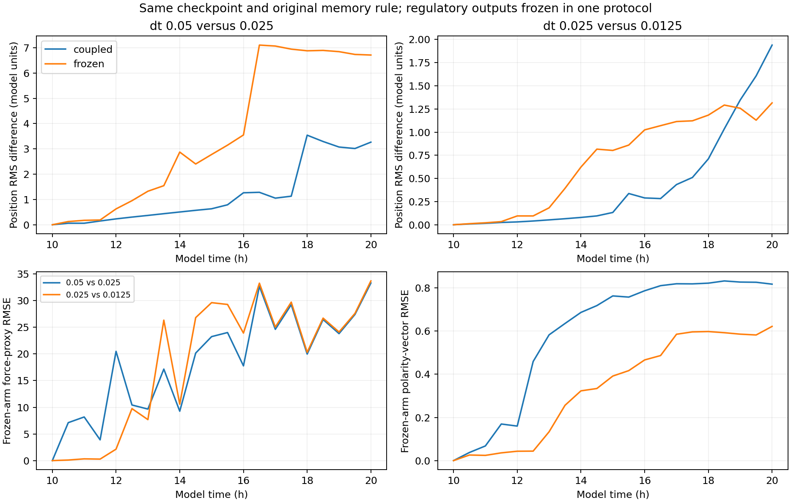

# E009: frozen regulation with active mechanics

Date: 2026-11-06 (Europe/Berlin). Internal protocol recorded before execution.

## Question

Does substantial timestep disagreement persist when evolving GRN-to-mechanics
feedback is removed? This is a diagnostic of the implemented mechanics,
not a model of normal developmental self-organization.

## Protocol

Restore the exact E007 complete seed-44 hour-10 checkpoint separately for
dt=0.05, 0.025 and 0.0125; run to hour 20 with half-hour observations.
Arrest radius growth and division as before. Keep ORIGINAL per-update
polarity memory 0.2, without E008 scaling, to isolate regulatory freezing.

Skip each cell's GRN integration after onset. Six regulatory nodes (SOX2,
SNAIL, YAP, Notch, cell cycle and HIF1a) and four outputs (adhesion,
protrusion, polarity bias and division rate) retain their checkpoint values.
Each cell preserves its own values; they are not homogenized between cells.
Cell.sync_phenotype continues copying those fixed outputs. Adhesion and
protrusive strengths and GRN polarity bias remain fixed. Mechanical position,
velocity, polarity DIRECTION, contact geometry and net-force proxy still evolve.

Fields continue sampling, consumption, deposition and diffusion/decay.
Cell oxygen/morphogen and GRN input buffers may update; neighbor signaling
and pressure are still recorded, but cannot change frozen nodes/outputs.
The existing discrete fate labels may change, but this mechanics does not
use those labels. Age can advance under the original oxygen gate.

No GRN random draws should occur because integration is skipped. The
midpoint generator remains installed to reject unplanned stochastic use.
No application model source is edited; the freeze is a runner intervention.

## Planned comparisons

Compare adjacent-timestep per-cell position RMS disagreements with E007's
evolving-GRN results over the entire curve, early (10,15] and late (15,20]
windows, and final time. Keep the same state, noise/growth policies and
original polarity memory. Secondary diagnostics: RMS tissue spread,
force-proxy RMSE, polarity-vector RMSE, fields and connectivity.

GRN RMSE must be ZERO by construction and high-SNAIL count constant; these
are manipulation checks, NOT evidence of numerical convergence. If position
disagreement persists, evolving regulation is not necessary for sensitivity
in this protocol. If it shrinks, that supports feedback amplifying differences
but does not uniquely identify a numerical mechanism. Frozen phenotypes also
change the trajectory and force regime, so this is a conditional comparison.

## Required checks

Exact initial checkpoint digest/array equality and unchanged source hashes;
256 fixed IDs/radii; 200/400/800 growth-arrest updates; exactly cell-count
times steps skipped GRN updates; ZERO actual random calls; constant nodes,
outputs and mechanical strengths; finite snapshots and monitored field bounds.
Checkpoint and intervention tests must pass. No production timestep is chosen.

## Implementation validation

Eleven tests passed: the eight E008 checkpoint/memory tests plus three
frozen-regulation tests. These confirm constant nodes/outputs while cells
move and fields change; preservation of different per-cell strengths;
and an updated pressure input that cannot change frozen YAP. Midpoint random
calls remain zero and skipped GRN calls are counted. Initial arrays match
exactly across all arms, including newly recorded output/strength matrices.

The no-op is installed on each GRN instance in the restored diagnostic copy.
It leaves signal-input buffers writable and preserves every cell-specific
checkpoint output. No global class or application source is patched.

Commands from repository root, using fresh output folders:

```powershell
rtk proxy python tools/branching_shared_state.py run --checkpoint research/experiments/2026-11-06-shared-state-timesteps/checkpoint --dt 0.05 --horizon 20 --sample-every 0.5 --freeze-regulation --output _branching_frozen_regulation_dt005
rtk proxy python tools/branching_shared_state.py run --checkpoint research/experiments/2026-11-06-shared-state-timesteps/checkpoint --dt 0.025 --horizon 20 --sample-every 0.5 --freeze-regulation --output _branching_frozen_regulation_dt0025
rtk proxy python tools/branching_shared_state.py run --checkpoint research/experiments/2026-11-06-shared-state-timesteps/checkpoint --dt 0.0125 --horizon 20 --sample-every 0.5 --freeze-regulation --output _branching_frozen_regulation_dt00125
rtk proxy python tools/test_branching_shared_state.py
```

## Analysis definitions

Position disagreement is RMS Euclidean distance between matching cell IDs
in absolute coordinates, without rigid alignment, as in E007. Early and
late summaries are arithmetic means over the ten half-hour samples in
(10,15] and (15,20]. The shared initial zero-error point is excluded.

Force-proxy RMSE compares per-cell net-force MAGNITUDES, not full force
vectors or compressive stress tensors. Polarity-vector RMSE is over the
three stored components and all cells, not an angle. Field RMSE is descriptive:
with regulatory outputs frozen and growth arrested, fields do not feed back
into this mechanics. Grid excursions could limit field interpretation without
being the cause of a mechanical trajectory difference in this protocol.

The generic within-condition report retains a zero GRN-disagreement plot
as a manipulation check. The primary comparison figure instead displays
position disagreement, force-proxy disagreement and polarity disagreement;
it does not treat the imposed zero GRN error as numerical improvement.

## Results

All three arms completed to hour 20 within floating-point tolerance with
256 unchanged cell IDs/radii. All six nodes, four outputs and two actual
mechanical-strength columns are exactly constant in every stored snapshot.
Skipped GRN-update counts are 51,200, 102,400 and 204,800; actual midpoint
random-call counts are ZERO. Growth-arrest steps are 200, 400 and 800;
polarity-scaling counts are zero. All initial arrays match exactly across
arms. All 63 observations are finite and contain no out-of-grid cell centers.
Source hashes and the complete initial-state digest match E007.

All start at RMS radius 4.4391:

| dt (model h) | RMS radius at 20 h | Spread change, 10-20 h | Mean net-force magnitude at 20 h | Components at factor 1.25 |
| --- | --- | --- | --- | --- |
| 0.05 | 6.4869 | +46.13% | 0.6262 | 23 |
| 0.025 | 2.5493 | -42.57% | 26.3469 | 8 |
| 0.0125 | 2.6882 | -39.44% | 0.1848 | 8 |

The coarse step produces a much wider distribution; both smaller steps
produce more compact distributions. The middle and fine final spreads are
fairly close, but force magnitudes differ by about 143-fold at that sample.
Force values are model units and should not be interpreted as biological
pressure. Their different trajectories and packing regimes prevent treating
that ratio as an isolated force-law parameter effect.

## Timestep disagreement and comparison with E007

| Adjacent pair | Coupled early mean position difference | Frozen early mean | Coupled late mean | Frozen late mean | Coupled final | Frozen final |
| --- | --- | --- | --- | --- | --- | --- |
| 0.05 / 0.025 | 0.33156 | 1.29882 | 2.17013 | 6.18700 | 3.26547 | 6.71076 |
| 0.025 / 0.0125 | 0.05442 | 0.30731 | 0.84927 | 1.13677 | 1.93948 | 1.31540 |

The middle/fine final position difference is 1.749 mean cell radii; the
coarse/middle difference is 8.922 radii. The middle/fine difference is smaller
than E007 at the terminal sample but larger on average in both time windows.
No consistent improvement can be inferred from that terminal sample alone.

Final force-proxy RMSEs are 33.3017 (coarse/middle) and 33.6871 (middle/fine).
Polarity-vector component RMSEs are 0.8175 and 0.6218 respectively. All
pairwise GRN and SNAIL RMSEs are exactly zero by intervention, not numerical
convergence. High-SNAIL count remains zero and mean SNAIL stays 0.338427
because the selected checkpoint had no above-threshold cells.



## Interpretation

Evolving GRN feedback is NOT necessary for substantial timestep dependence
in this tested mechanical setup. Motion can diverge strongly while regulatory
nodes and phenotype outputs are held identical. That narrows the investigation
to the mechanical update, including adhesion/repulsion, contact changes,
protrusion, polarity direction and integration timing.

This does not uniquely identify a defect, prove instability, or establish
the finest arm as correct. Original per-update polarity memory remains in
the mechanical scheme. Freezing outputs also changes force/packing history
relative to coupled controls, so the numerical difference cannot be
attributed quantitatively to "GRN amplification" alone. In some regimes
regulatory changes may alter stiffness or contact structure; that hypothesis
has not been isolated.

The smaller steps have similar macroscopic spread but different individual
trajectories and force readouts. A future convergence target should specify
which observables matter for the research, with tolerances and checks across
additional states. One checkpoint, three steps, five-hour summary windows and
one ten-hour diagnostic trajectory do not settle that target.

No biological branching or leader behavior is inferred from frozen-state
diagnostics. Application code remains unchanged and no production timestep
is selected.

## Next diagnostic proposal (not run)

Disable protrusive force in this frozen-regulation protocol, retaining
adhesion and repulsion. Then polarity direction would no longer contribute
to translational force, providing a cleaner test of pair interactions and
their time integration. If sensitivity persists, test mechanical substeps
before changing force laws or tuning biological mechanisms. Both would be
explicit diagnostic interventions, not silent application changes.

## Artifacts and reproduction

dt005, dt0025 and dt00125 preserve all 63 new observations, streaming CSVs,
settings and completion summaries. Each snapshot additionally stores
regulatory_outputs in order adhesion/protrusion/polarity_bias/division_rate,
and mechanical_strengths in order adhesion_strength/protrusion_strength.
Gene order follows E007. The complete initial checkpoint remains in E007.

analysis preserves final summaries and pairwise differences (including added
force-proxy and polarity-vector RMSE fields). comparison preserves the E007
versus E009 summary, a figure and input hashes. Source copies preserve the
runner, helper, report scripts and eleven-test file. sha256.json hashes local
artifacts except itself. Earlier experiment data and source copies were not
overwritten. The current report helper adds mechanical diagnostics; archived
earlier report implementations remain available for exact historical output.

Run from repository root using fresh output folders:

```powershell
rtk proxy python tools/branching_shared_state_report.py research/experiments/2026-11-06-frozen-regulation/dt005 research/experiments/2026-11-06-frozen-regulation/dt0025 research/experiments/2026-11-06-frozen-regulation/dt00125 --output _frozen_regulation_analysis_reproduction
rtk proxy python tools/branching_frozen_comparison.py --coupled research/experiments/2026-11-06-shared-state-timesteps/analysis --frozen _frozen_regulation_analysis_reproduction --output _frozen_regulation_comparison_reproduction
```
