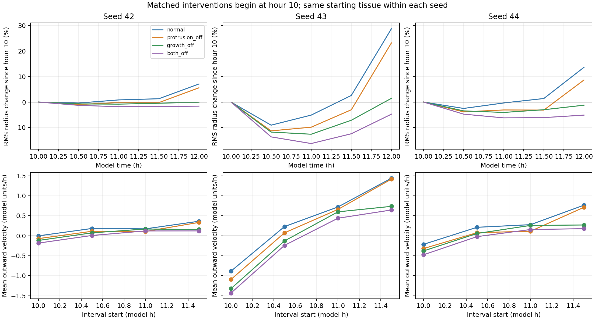

# E005: delayed growth arrest and combined ablation

Date: 2026-11-06 (Europe/Berlin).

## Protocol recorded before execution

Question: does outward motion require ongoing radius growth and division,
and does protrusion still contribute when growth is absent?

Complete a 2-by-2 intervention comparison after hour 10:

| Condition | Radius growth and division | Protrusive force | Data |
| --- | --- | --- | --- |
| Normal | On | On | Archived E002 |
| Protrusion off | On | Off | Archived E004 |
| Growth off | Off | On | New run |
| Both off | Off | Off | New run |

All arms use seeds 42, 43 and 44, dt=0.05, horizon 12 h and half-hour samples.
New arms follow the unchanged rules through hour 10. The runner then sets
the radius growth rate to zero and prevents divisions during each update.
Biological age still advances when the original growth method is called;
regulatory cell-cycle activity, chemicals and mechanics remain active.
The growth rate and division method are restored after each update. The
combined arm also suppresses protrusive force using the E004 intervention.
Model source files are not edited.

Primary descriptive outcomes: outward velocity per matched half-hour interval
and its equally weighted mean across the four intervals. Secondary outcomes:
RMS radius change from hour 10, final cell counts, high-SNAIL states,
connectivity, elongation and chemical-grid excursions.

Predictions: reduced motion under growth arrest would support a role for
ongoing growth/division in expansion. Motion in both-off arms would reflect
remaining dynamics, including adhesion/repulsion and relaxation of the
pre-existing geometry; it should not be called active motility. Comparing
growth-off with both-off tests protrusion's effect without concurrent growth.
Interactions between interventions may prevent additive attribution.

Validation: all stored arrays through hour 10 must match E002; each new arm
must have 40 growth-arrest steps. Cell IDs and radii must remain unchanged
after the switch and no post-switch divisions should be counted. Combined
arms must also have 40 protrusion-ablation steps. All source hashes must match.

These artificial interventions test this computational model, not biological
growth inhibition. Growth arrest changes cell number, chemical production,
consumption and neighbor history relative to growing controls through
feedback. Random streams can diverge once division is suppressed.

Commands from repository root:

```powershell
rtk proxy python tools/branching_baseline.py --hours 12 --dt 0.05 --seeds 42 43 44 --sample-every 0.5 --growth-off-at 10 --output _branching_growth_off10
rtk proxy python tools/branching_baseline.py --hours 12 --dt 0.05 --seeds 42 43 44 --sample-every 0.5 --growth-off-at 10 --protrusion-off-at 10 --output _branching_both_off10
```

## Results

All six new runs reached hour 12. All 126 pretreatment snapshots matched
E002 exactly for every stored array. Cell IDs and radii stayed exactly fixed
after hour 10; there were no subsequent divisions. Each run had 40
growth-arrest steps; combined runs also had 40 protrusion-ablation steps.
All new snapshots contain finite arrays and model source hashes match E002.
Four intervention tests passed, covering already division-ready cells,
boundary timing, parameter restoration after an exception, and combined
switch operation. Regulatory updates and biological age were checked to
continue during growth arrest.

### Tissue spread

Change in RMS radius between hours 10 and 12, relative to hour 10:

| Seed | Normal | Protrusion off | Growth off | Both off |
| --- | --- | --- | --- | --- |
| 42 | +7.08% | +5.57% | -0.06% | -1.60% |
| 43 | +28.72% | +23.16% | +1.46% | -4.75% |
| 44 | +13.59% | +8.63% | -1.23% | -5.11% |

These percentages compare each arm's final spread with its OWN hour-10
spread, identical between arms within each seed. They are not the percentage
reductions relative to control reported in E004. Positive means wider spread;
negative means contraction. RMS radius is a distribution statistic, not an
outer boundary or branch length.

### Projected motion

Equally weighted means of the four half-hour outward-velocity means:

| Seed | Normal | Protrusion off | Growth off | Both off |
| --- | --- | --- | --- | --- |
| 42 | 0.17838 | 0.11971 | 0.06952 | 0.01596 |
| 43 | 0.37580 | 0.26373 | -0.03007 | -0.14812 |
| 44 | 0.25922 | 0.14479 | 0.05072 | -0.04186 |

Units are model length per model hour. The protrusion contrast with growth
off (growth_off minus both_off) is +0.05356, +0.11805 and +0.09258,
respectively. Thus protrusion increases this motion measure even without
ongoing growth. Growth contrasts are also positive in every seed with either
protrusion setting. Full factorial contrasts are archived, without statistical
inference or a claim that the mechanisms contribute additively.

RMS spread and projected mean velocity are DIFFERENT measures: the former
weights distant cells more strongly; the latter projects displacements on
starting radial directions and averages cells/intervals. Tangential movement,
changes of direction and rearrangement can make their signs differ. Neither
is an exact expansion rate. For example, growth-off seed 43 has negative
mean projected velocity but slightly increased final RMS radius.



### Other observations

All growth-arrested arms end at 256 cells. Normal arms end at 919, 849 and
938; protrusion-off arms at 913, 834 and 936. Absolute marker counts therefore
cannot be compared as if population sizes were equal:

| Seed | High-SNAIL normal | Protrusion off | Growth off | Both off |
| --- | --- | --- | --- | --- |
| 42 | 17 / 919 | 17 / 913 | 1 / 256 | 0 / 256 |
| 43 | 73 / 849 | 108 / 834 | 45 / 256 | 35 / 256 |
| 44 | 24 / 938 | 31 / 936 | 14 / 256 | 8 / 256 |

No new arm has cell centers outside the chemical field at the final sample.
Seed 42 retains multiple proximity components at factor 1.25: 21 with growth
off (largest share 0.4883), and 12 with both off (largest share 0.7422).
Its starting tissue already had 52 components by this threshold. This does
not show loss of physical connectivity: mechanics acts out to a different,
fixed interaction radius, and proximity thresholds are definition-sensitive.
Other growth-arrested seeds have one final proximity component.

## Interpretation

Ongoing growth/division contributes strongly to increased spread during
this window in these three realizations. Removing that combined process
largely removes the net RMS spread increase. This does not distinguish
radius growth from division, since both were suppressed together.

Protrusion still contributes without growth, but it has not been shown to
generate sustained connected sprouts. Both-off tissues continue rearranging
and contract in RMS spread. Remaining adhesion/repulsion and relaxation of
the initial geometry can support motion without cell growth or protrusion.
Regulation still affects adhesion during these runs, so both-off does not
mean all active biochemical state changes have been removed.

These observations refine the working picture: population growth promotes
expansion, protrusion offsets some contraction and adds outward motion,
but neither demonstrated effect establishes organized branching. Do not
equate an expansion phenotype or high-SNAIL state with a branch phenotype.

## Limits and next question

- Three exploratory seeds, one timestep, two-hour intervention window;
  no inferential statistics or biological validation.
- Radius growth and division are a joint intervention. Cell-cycle regulation
  continues even though its growth output is blocked.
- Suppressing division changes subsequent random draws and cell numbers;
  treatments are matched at onset, not identical stochastic paths afterward.
- Altered density, field consumption/production, adhesion and GRN history
  are part of the total effect, not controlled independently.
- The seed-42 both-off high-SNAIL group is empty. Its geometry means are
  undefined (NaN in final_groups.csv); NumPy emitted empty-group warnings.
  These values are not zero and are not used in primary motion comparisons.
- Snapshot cadence cannot establish fine-scale movement persistence or
  distinguish every transient protrusion from a persistent branch.

Next question: does a fixed-population tissue, given more regulatory time,
develop localized surface motility or simply rearrange as a rounded group?
A longer growth-arrested observation can test that separately from continued
population expansion. It must be labeled as an artificial fixed-size protocol,
with explicit boundary, timestep and contact-threshold checks. It has not
been run beyond hour 12 in this record.

## Reproduction and provenance

growth_off and both_off preserve settings, 150 snapshots total, CSVs and
stop summaries. The two trajectory folders preserve geometry and lineage
measurements. comparison.json identifies all four data sources explicitly.
condition_summary.csv, interval_summary.csv and factorial_contrasts.csv
preserve report outputs. report_provenance.json hashes report inputs and
the report script; sha256.json hashes local artifacts except itself.
Copies of the runner, analysis and intervention tests are included.
Sources copied from the earlier controls remain in E002. Nothing in E002,
E003 or E004 was overwritten.

Use fresh output folders when reproducing runs or trajectory analysis. The
following report command uses the preserved observations:

```powershell
rtk proxy python tools/branching_factorial_report.py research/experiments/2026-11-06-growth-arrest/comparison.json --output _growth_arrest_report_reproduction
rtk proxy python tools/test_branching_interventions.py
```
