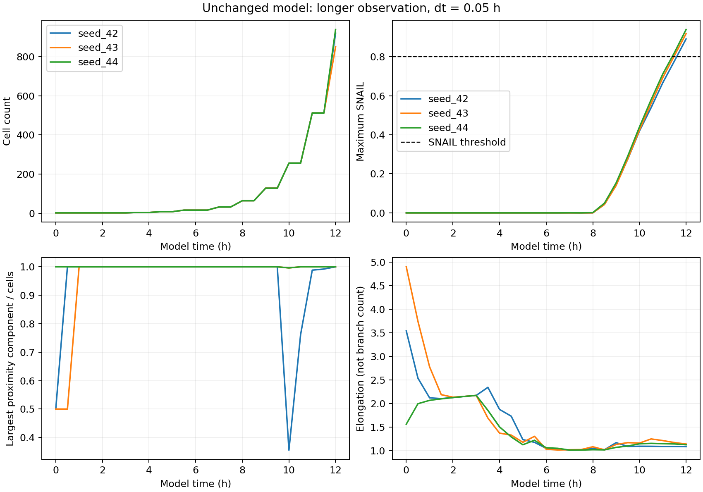
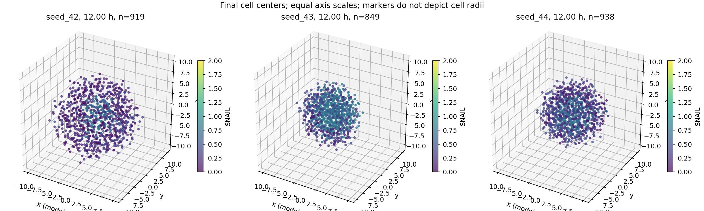

# Experiment E002: longer observation of the unchanged model

Date: 2026-11-06 (Europe/Berlin).

## Question and hypothesis

Does the coupled tissue begin producing high-SNAIL states after the original
10-hour observation window? The working hypothesis was that regulatory
activation needed more time. This experiment does not test a new mechanism.

## Method

- Existing model equations, parameters, two-cell initialization and 1500-cell
  cap unchanged; independent seeds 42, 43 and 44.
- Requested horizon 12 model hours; fixed dt=0.05; observations every 0.5 h.
- Connectivity factor 1.25; high-SNAIL threshold strictly greater than 0.8.
- Runner stops at the requested horizon or application cell limit, whichever
  comes first. All three runs reached the horizon without reaching the cap.
- NumPy 1.26.4. Full Python version, UTC execution timestamp, source hashes
  and settings are in each run's settings.json.

Commands, from repository root:

```powershell
rtk proxy python tools/branching_baseline.py --hours 12 --dt 0.05 --seeds 42 --sample-every 0.5 --output _branching_long_12h_seed42
rtk proxy python tools/branching_baseline.py --hours 12 --dt 0.05 --seeds 43 44 --sample-every 0.5 --output _branching_long_12h_seeds43_44
```

Choose fresh output folders when repeating. The runner refuses nonempty
folders to protect prior experiments.

## Observations

| Seed | Cells at 12 h | High-SNAIL cells | Share | Max SNAIL | Elongation | Outside field |
| --- | --- | --- | --- | --- | --- | --- |
| 42 | 919 | 17 | 1.85% | 0.8917 | 1.0841 | 3 |
| 43 | 849 | 73 | 8.60% | 0.9188 | 1.1392 | 0 |
| 44 | 938 | 24 | 2.56% | 0.9398 | 1.1247 | 0 |

First sampled nonzero high-SNAIL counts occur at 12 h for seed 42 and
11.5 h for seeds 43 and 44. Actual threshold crossings lie between samples;
these are not exact activation times. Daughter inheritance also means a
high-SNAIL count is not a count of independent activation events.

All final snapshots have one component at factor 1.25. At factor 1.0,
largest-component shares are 0.7878, 0.9694 and 0.9456 respectively;
at factor 1.5 all are 1.0. Connectivity remains definition-sensitive.

Seed 42 has 52 components at 10 h, 8 at 10.5 h, 4 at 11 h, 3 at 11.5 h,
and 1 at 12 h under the same threshold. The dip at 10 h coincides with
128 parent divisions in the previous half-hour. This supports a transient
interpretation of that dip, but does not establish division as its sole cause.

The ratio of mean distance from tissue centroid for high-SNAIL cells to
that for all cells is 0.5058, 0.9308 and 0.6938 for seeds 42, 43 and 44.
High-SNAIL cells are therefore not preferentially farther from the centroid
by this aggregate measure. This is not a local surface or tip detector.





The plotted cell centers remain approximately round distributions; no
clear macroscopic branching is apparent in these views. Neither elongation
nor a single 3D projection can rule out every local protrusion.

## Interpretation

The longer window supports delayed high-SNAIL activation in the coupled
model. It does not yet demonstrate leader function, persistent sprouts,
or branching. A high regulatory marker and an advancing tissue tip must be
treated as different observations.

## Limitations and next question

- Three seeds are exploratory, not evidence of general statistical behavior.
- No timestep convergence study was completed for the 12-hour window.
- Three cell centers in seed 42 leave the chemical grid. Sampling clamps
  positions to the edge; movement is not confined by the grid bounds.
  This affects interpretation of chemical feedback and must be addressed
  explicitly in subsequent experiment design.
- Stored snapshots contain selected diagnostics, not the complete field,
  RNG and cell state required for exact checkpoint continuation.
- Growth is rapid, approaching the application cap soon after this horizon.
  Continuing after the cap or imposing growth arrest would constitute a
  separate protocol and should not silently replace the baseline.
- Force magnitude is a net-force proxy, not a validated compressive stress.

Next question: do activated cells sustain directional motion at a local
tissue surface while retaining followers, or do they remain internal?
Answer this with trajectory and neighborhood analysis before choosing a
mechanistic intervention. Account for cell division when tracking identity.

## Provenance and verification

This folder preserves raw CSVs, NPZ observations, run settings, source copies,
the runner and plotting script. sha256.json records hashes of data and source
artifacts (figures excluded). No model source was edited for this experiment.
Files are present in the working tree; this is not an external backup.

Instrumentation was compared with the earlier seed-42 snapshot at hour 10:
cell IDs matched, maximum positional difference was 4.32e-14 and maximum
SNAIL difference 1.89e-15. The older horizon ends at exactly 10.0, while the
longer run samples at 10.000000000000007, explaining rounding differences.

Rebuild figures using the live tools or the archived plotting script, with
the two archived run folders as inputs. Figures show cell centers with equal
axis scales and a common SNAIL color scale; marker sizes are not cell radii.
