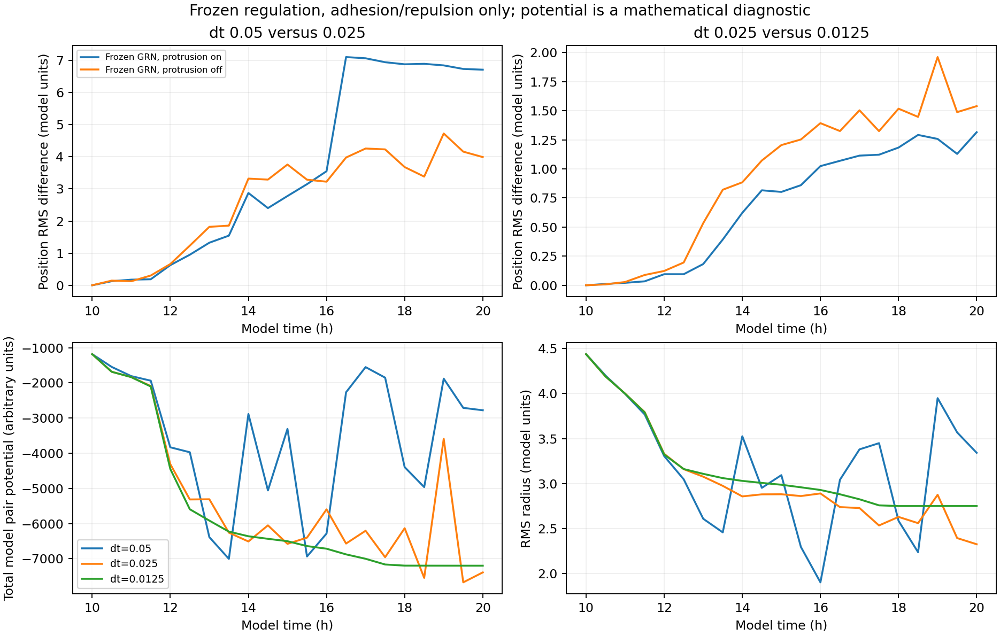

# E010: frozen regulation and protrusion off

Date: 2026-11-06 (Europe/Berlin). Internal protocol recorded before execution.

## Question

Does timestep sensitivity persist with only pairwise adhesion and repulsion
driving translation? E009 showed sensitivity without evolving regulation;
this removes the protrusive force and its directional contribution.

## Protocol

Restore the exact E007 complete seed-44 hour-10 checkpoint for dt=0.05,
0.025 and 0.0125. Run to hour 20 with half-hour observations, 256 fixed
cell IDs/radii and no division. Freeze six GRN nodes and four phenotype
outputs at their per-cell checkpoint values as in E009. Disable protrusive
force during every mechanics call using the existing temporary ablation
wrapper. Restore stored phenotype strengths after each call.

The snapshot mechanical_strengths matrix records restored phenotype values;
the new effective_protrusion_strength array is zero, recording the intervention
used in force evaluation. Adhesion is neither removed nor homogenized.

Polarity direction and neighbor inputs may still update, with original memory
0.2. With zero protrusive force and fixed regulation, these do not contribute
to translation. Fields, environmental inputs, age and fate-label logic still
update but cannot alter the frozen mechanical outputs. No GRN random draws
occur. Application source and force laws remain unchanged.

"Passive" here refers only to removing active protrusive force from this
computational force balance. Adhesion is still represented by the existing
model force and is not a claim about biological thermodynamic passivity.

## Planned comparisons and checks

Compare adjacent-timestep per-cell position RMS disagreement with E009 over
full timecourses, early (10,15], late (15,20] and final time. Secondary:
RMS spread, force-proxy RMSE, contact components and field bounds. Remaining
sensitivity would show that ongoing regulation and protrusion are not required
in this diagnostic regime. It would not isolate integration versus cutoff
handling, or identify an appropriate production timestep.

All arms must share the complete checkpoint and initial model state. Nodes,
outputs, restored strengths, IDs and radii stay fixed; effective protrusion
is zero; random calls are zero. Growth-arrest and protrusion-off step counts
must be 200/400/800, and skipped GRN calls 256 times step count. All stored
arrays must be finite.

Since only symmetric internal pair forces drive positions, check centroid
drift relative to onset as a numerical diagnostic. Test simple two-cell
adhesion and repulsion against their expected updates, and verify that
changing polarity memory cannot change translational trajectories with
protrusion suppressed. Finite snapshots or a conserved centroid alone do
not establish convergence, stability or physical accuracy.

This is one checkpoint, three timesteps and an artificial frozen-population
protocol. It does not test biological branch formation or reproduce normal
growing self-organization.

## Exploratory potential diagnostic added during execution

The source pair force inside cutoff R is attraction A=a_i*a_j minus
repulsion k*max(c-r,0), where c is summed radius. Its corresponding radial
potential, set to zero outside R, is

`U_ij(r) = A*(r-R) + k/2 * [max(c-r,0)^2 - max(c-R,0)^2]` for r<=R.

This is continuous at R, and its radial derivative is the implemented
attraction-minus-repulsion strength. The adhesion distance multiplier in
the source is exactly 1 inside the cutoff. This derivation assumes the
near-zero-distance force-skip regime is not active; saved near-zero pair
counts will be recorded separately.

For the corresponding continuous overdamped pair-force motion with common
positive damping b, dU/dt = -sum_i(|F_i|^2)/b <= 0 away from singular/skip
events. Thus sampled increases in this mathematical potential can flag
non-dissipative finite-step behavior under the tested discrete update. They
are not biological energy measurements, and saved samples cannot detect
every within-interval increase. No inference about convergence follows from
monotone sampled energy alone. This was added after runs started and is
explicitly exploratory, not part of an external preregistration.

## Implementation validation

Sixteen tests passed. The fourteen existing checkpoint/intervention tests
now include exact two-cell adhesion/repulsion updates and invariance of
translation to polarity memory with protrusion off. Two new potential tests
compare its finite-difference gradient against the ORIGINAL mechanics force
for a three-cell configuration and check continuity at the cutoff (including
contact radii larger than the cutoff). These validate the diagnostic formula,
not biological accuracy or convergence of a population run.

The exact initial complete-state digest remains E007's. The current runner
stores an explicit protrusion-off flag, counts ablated calls, and records
effective zero coefficients separately from restored phenotype strengths.
Initial saved arrays match across arms; initial pressure still describes
the PRE-intervention checkpoint force. Subsequent force observations describe
the adhesion/repulsion-only updates.

Commands from repository root with fresh output folders:

```powershell
rtk proxy python tools/branching_shared_state.py run --checkpoint research/experiments/2026-11-06-shared-state-timesteps/checkpoint --dt 0.05 --horizon 20 --sample-every 0.5 --freeze-regulation --protrusion-off --output _branching_passive_dt005
rtk proxy python tools/branching_shared_state.py run --checkpoint research/experiments/2026-11-06-shared-state-timesteps/checkpoint --dt 0.025 --horizon 20 --sample-every 0.5 --freeze-regulation --protrusion-off --output _branching_passive_dt0025
rtk proxy python tools/branching_shared_state.py run --checkpoint research/experiments/2026-11-06-shared-state-timesteps/checkpoint --dt 0.0125 --horizon 20 --sample-every 0.5 --freeze-regulation --protrusion-off --output _branching_passive_dt00125
rtk proxy python tools/test_branching_shared_state.py
```

## Results

All three arms reached hour 20 with 256 fixed IDs/radii. All six regulatory
nodes, four outputs and restored mechanical strengths stayed exactly constant.
Effective protrusion coefficients were zero in all observations. Random calls
were zero; skipped GRN calls were 51,200/102,400/204,800. Growth-arrest and
protrusion-off counts were 200/400/800. All 63 observations were finite,
initial arrays matched exactly, and no saved center left the chemical grid.
Application source hashes and the complete checkpoint digest match E007.

| dt (model h) | Final RMS radius | Final mean net-force magnitude | Final components at factor 1.25 | Largest component fraction |
| --- | --- | --- | --- | --- |
| 0.05 | 3.3416 | 34.4660 | 3 | 0.9922 |
| 0.025 | 2.3247 | 19.6823 | 6 | 0.7461 |
| 0.0125 | 2.7495 | 0.0437 | 6 | 0.6719 |

Force values are model units and not biological pressure. Low final force
in the finest arm is compatible with relaxation, but does not prove global
equilibrium, stability at every step or convergence. Different final radii
or component counts do not by themselves establish branch formation.

## Position disagreement versus E009

E009 is frozen regulation with protrusion ON; E010 also disables protrusion.
Each number compares two timesteps WITHIN that protocol:

| Pair | E009 early mean | E010 early mean | E009 late mean | E010 late mean | E009 final | E010 final |
| --- | --- | --- | --- | --- | --- | --- |
| 0.05 / 0.025 | 1.29882 | 1.65097 | 6.18700 | 3.89114 | 6.71076 | 3.99033 |
| 0.025 / 0.0125 | 0.30731 | 0.49595 | 1.13677 | 1.47528 | 1.31540 | 1.53954 |

The E010 middle/fine final position disagreement is 2.047 mean cell radii;
coarse/middle is 5.305 radii. Freezing regulation and disabling protrusion
does not remove timestep sensitivity. Changes relative to E009 depend on
the pair and time window; this is not a uniform stabilization effect.

## Potential and centroid diagnostics

All arms start at total model pair potential -1181.6845. Negative values
reflect the chosen zero at the interaction cutoff; these are arbitrary
computational units, not joules or a biological free-energy measurement.

| dt | Final potential | Largest increase between saved observations | Increases above tolerance | Maximum centroid drift |
| --- | --- | --- | --- | --- |
| 0.05 | -2778.0741 | +4119.9844 | 6 | 1.36e-15 |
| 0.025 | -7389.7685 | +3956.4773 | 8 | 1.25e-15 |
| 0.0125 | -7198.4700 | 0 | 0 | 1.85e-15 |

Increases are counted above 1e-9 times max(1,max absolute saved potential)
within an arm, giving thresholds about 7e-6 units. The coarse increases
are vastly larger than that numerical tolerance. The finest arm's largest
half-hour change is still NEGATIVE (-0.2657), so all twenty sampled changes
are decreasing. Saved near-zero-distance pair counts are zero in all arms;
within-interval skip events were not directly logged.

The centroid is the unweighted mean cell center, appropriate to checking
the common-damping pair update; this is not a momentum-conservation claim
for an inertial model. Its approximately 1e-15 drift is consistent with
symmetric internal forces. Conserving this centroid clearly does not prevent
large trajectory and potential discrepancies.



The dt=0.025 final potential is lower than dt=0.0125, yet its trajectory has
large repeated increases. Ranking methods by only final potential would
therefore be misleading. The trace and force readouts matter, not only the
endpoint.

## Interpretation

Ongoing GRN feedback, active protrusion and polarity-dependent translation
are NOT required for substantial sensitivity in this tested setup. With
only the existing adhesion/repulsion pair forces active, large timestep
differences remain.

The potential derivation gives a stronger diagnostic than state differences
alone: the corresponding continuous passive overdamped dynamics dissipate
this potential away from the tiny-distance skip regime. Large sampled
increases at dt=0.05 and 0.025 are strong evidence of non-dissipative
finite-step behavior/overshoot in this protocol. They should not be
interpreted as biological work or self-organized branching activity.

This does not prove the finest step is converged or globally optimal.
Half-hour sampling can hide intermediate increases; a finer timestep and
additional states are still needed. Neighbor-cutoff changes and close-contact
geometry remain part of the force/integration scheme. The source force law
was not altered, and the near-zero-distance exception limits the exact
gradient interpretation if it becomes active. No biological validation or
production timestep is claimed.

## Next numerical test proposal (not run)

Refine this same passive diagnostic further and/or test mechanical substeps
with potential and force monitoring before changing biological rules.
After verifying passive behavior, retest evolving-regulation and protrusive
conditions. Potential decrease is NOT a requirement for the full active,
growing model: protrusion, phenotype changes and growth can legitimately
change this potential or do work. A passive energy check must not be blindly
enforced on the full model as a way to suppress desired active behavior.

## Artifacts and reproduction

dt005/dt0025/dt00125 preserve the 63 snapshots, settings, timecourses and
completion summaries. analysis preserves pairwise state, field and force
differences. comparison preserves potential/centroid timecourses, invariant
summaries, E009/E010 contrasts, a figure and input/helper hashes.
The complete checkpoint remains in E007; original application sources remain
in E002 and source hashes are checked. Runner/helper/report and sixteen-test
copies are included. sha256.json hashes local artifacts except itself.
Earlier records were not overwritten.

From repository root, using fresh output folders:

```powershell
rtk proxy python tools/branching_shared_state_report.py research/experiments/2026-11-06-passive-mechanics/dt005 research/experiments/2026-11-06-passive-mechanics/dt0025 research/experiments/2026-11-06-passive-mechanics/dt00125 --output _passive_analysis_reproduction
rtk proxy python tools/branching_passive_report.py research/experiments/2026-11-06-passive-mechanics/dt005 research/experiments/2026-11-06-passive-mechanics/dt0025 research/experiments/2026-11-06-passive-mechanics/dt00125 --checkpoint research/experiments/2026-11-06-shared-state-timesteps/checkpoint --reference-analysis research/experiments/2026-11-06-frozen-regulation/analysis --passive-analysis _passive_analysis_reproduction --output _passive_report_reproduction
```
