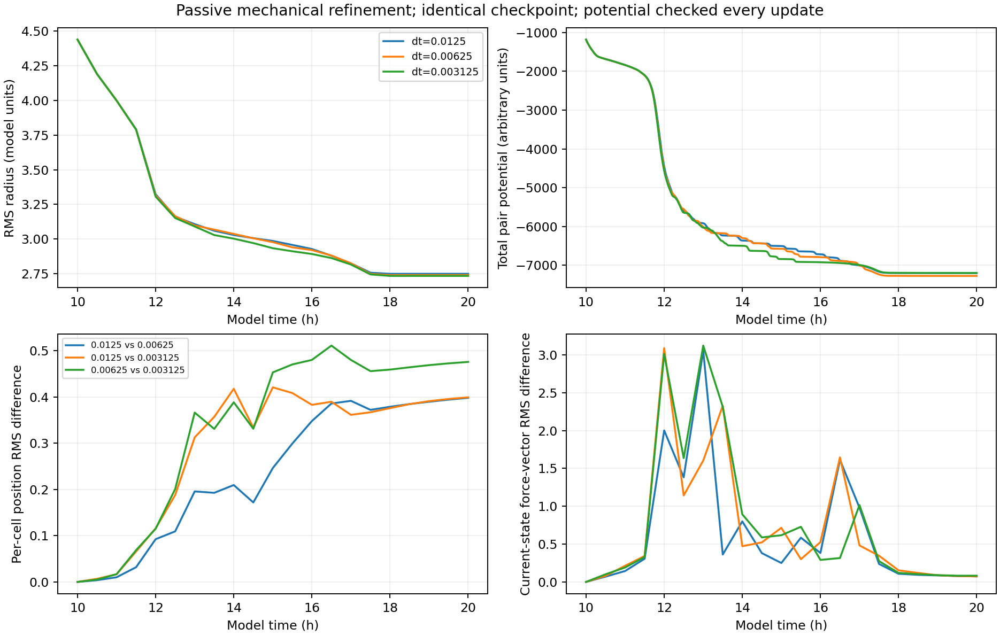

# E011: finer passive mechanical stepping

Date: 2026-11-06 (Europe/Berlin). Internal protocol recorded before execution.

## Question and design

Do finer steps reduce passive mechanical disagreement and avoid the potential
increases found in E010? From the EXACT E007 complete hour-10 checkpoint,
run passive pair mechanics at dt=0.0125, 0.00625 and 0.003125 to hour 20.
Save half-hour observations and a potential/centroid diagnostic EVERY step.
Freeze radii, regulation and cell count; omit noise and protrusive force.

## Mechanics-only diagnostic implementation

The original pair-force calculation and accumulation order are copied into
a diagnostic helper. Only the force integration advances positions, velocities
and the force proxy. Unused chemical fields, age, fate, input buffers and
polarity are not advanced. In this passive frozen regime they cannot affect
translation. The original complete checkpoint is decoded and verified before
extracting cells, and original cell iteration order is retained.

This is a reduced diagnostic, not an alternative implementation of the full
biological simulator. Require the repeated dt=0.0125 control to match E010
positions and pressure arrays EXACTLY at all shared observations before
interpreting finer runs. Compare one-step forces/velocities and position
updates against original mechanics in tests. Unchanged frozen outputs/radii,
effective zero protrusion, finite observations and source/checkpoint hashes
are additional checks. No application source or force rule changes.

The E010 NPZ files do not store velocity, so full-control velocity equality
must be checked as a velocity-MAGNITUDE relation to stored pressure/damping
or a fresh original-kernel test; exact full-run positions/pressure are the
primary historical replay checks. Initial velocity describes the preceding
active step and is excluded from passive zero-force interpretation.

## Planned comparisons

Compare all timestep pairs at common half-hour times: per-cell position RMS
distance (absolute coordinates, fixed IDs), spread, force magnitudes,
connectivity and final/temporal potential. Compare adjacent refinements across
early (10,15] and late (15,20] windows, not just terminal marker counts.

Track every-step potential changes using tolerance
1e-9*max(1,abs(current U),abs(previous U)). Track near-zero pair counts
(source force skips distances <1e-8) and centroid drift at every step.
Potential monotonicity is only a passive consistency check, not proof of
trajectory convergence. The finest arm is a reference, not known truth.

No acceptance tolerance for the full biological model is selected. This is
one initial state, a ten-hour frozen diagnostic and a non-smooth neighbor
cutoff. Close agreement would justify further tests, not general convergence.

## Implementation checks and rejected optional optimization

Eighteen tests passed: the prior sixteen checkpoint/intervention/potential
checks plus repeated exact comparisons of the mechanics-only pair path with
the original class across multiple timesteps, and checks that omitted state
remains unchanged while the centroid is conserved. A separate 256-cell
checkpoint one-step check also matched positions, velocities and pressure
EXACTLY against the original mechanics.

An optional strict serial Numba prototype was tested during execution to
reduce runtime. It failed the required exact-replay criterion in its first
256-cell step: maximum position difference 4.44e-16, velocity difference
1.78e-15 and pressure difference 3.55e-15. These are roundoff-sized, not
evidence of an invalid compiler, but the prototype was NOT used in any
experiment arm. Its source and rejection measurements are preserved separately.
All scientific run results use the reference-ordered Python pair calculation.

The full dt=0.0125 mechanics-only replay completed with EXACT position and
pressure equality in all 21 observations against E010. Its 800 individual
updates also showed zero potential increases above tolerance. This validates
the reduced path for the retained translational observables on this replay,
not equivalence of omitted field/polarity/fate histories.

For force comparisons at a COMMON saved time, the report evaluates the
ordered passive pair calculation on COPIED saved positions with dt=0.
The probe does not advance the state. This avoids comparing forces evaluated
at t-dt in different arms: raw stored velocity/pressure normally belongs to
the latest completed update. A source-kernel test verifies the zero-step
probe's force values and unchanged input positions.

Nineteen tests now pass, including that common-time force probe. The two
additional pair-path tests cover exact repeated source-kernel equality over
multiple timesteps and the independence of omitted state/centroid checks.
The optional compiled rejection is preserved as a validation outcome, not
as a scientific timestep arm.

Commands from repository root with fresh output folders:

```powershell
rtk proxy python tools/branching_passive_refinement.py --checkpoint research/experiments/2026-11-06-shared-state-timesteps/checkpoint --dt 0.0125 --horizon 20 --sample-every 0.5 --output _branching_refinement_dt00125
rtk proxy python tools/branching_passive_refinement.py --checkpoint research/experiments/2026-11-06-shared-state-timesteps/checkpoint --dt 0.00625 --horizon 20 --sample-every 0.5 --output _branching_refinement_dt000625
rtk proxy python tools/branching_passive_refinement.py --checkpoint research/experiments/2026-11-06-shared-state-timesteps/checkpoint --dt 0.003125 --horizon 20 --sample-every 0.5 --output _branching_refinement_dt0003125
rtk proxy python tools/test_branching_shared_state.py
```

## Results and verification

All three arms reached hour 20 within floating-point tolerance with 256 fixed
IDs/radii, frozen nodes/outputs and effective zero protrusion. All 63 saved
observations contain finite arrays. The complete initial digest matches E007;
application source hashes remain unchanged. All 5,603 trace rows are present
(5,600 updates plus one initial row per arm), with consecutive step indices.
No near-zero-distance pair occurred at any evaluated step; no saved center
left the field bounds. The fields themselves were not advanced in this
reduced diagnostic and play no role in the retained mechanics.

| dt (model h) | Updates | Potential increases above tolerance | Final RMS radius | Final potential | Mean force at current final state |
| --- | --- | --- | --- | --- | --- |
| 0.0125 | 800 | 0 | 2.74950 | -7198.4700 | 0.04366 |
| 0.00625 | 1600 | 0 | 2.74031 | -7272.6716 | 0.04864 |
| 0.003125 | 3200 | 0 | 2.73437 | -7195.8913 | 0.03947 |

Every-update potential monitoring confirms the passive consistency result
for these steps, rather than relying only on E010's half-hour samples.
Maximum centroid drift is approximately 1.85e-15, 2.02e-15 and 2.29e-15.

The final RMS spread range is 0.554% of the finest arm's spread. Adjacent
relative spread differences are 0.336% and 0.217%. Elongations are 1.7085,
1.6890 and 1.7207, respectively. All arms have six proximity components at
factor 1.25, with largest-component fractions 0.6719, 0.6758 and 0.6719.
These similar aggregate values are observations, not an acceptance threshold
selected for the full biological model.

## Individual trajectory and force agreement

Per-cell position RMS distances use fixed IDs and absolute coordinates.
Current-state force differences are RMS Euclidean distances between force
vectors evaluated at the SAME saved time, not the pre-update force buffers.

| Pair | Early mean position difference | Late mean | Final position difference | Final difference in mean cell radii | Final force-vector RMS difference |
| --- | --- | --- | --- | --- | --- |
| 0.0125 / 0.00625 | 0.12633 | 0.37408 | 0.39798 | 0.5291 | 0.07340 |
| 0.0125 / 0.003125 | 0.22338 | 0.38540 | 0.39907 | 0.5305 | 0.07306 |
| 0.00625 / 0.003125 | 0.22758 | 0.47364 | 0.47558 | 0.6323 | 0.08232 |

Smaller steps do not monotonically reduce individual positional disagreement.
Final force differences remain comparable to or larger than the small mean
force magnitudes, despite their much smaller absolute scale than the E010
large-step fluctuations. Different nearly relaxed cell arrangements can
therefore coexist with close agreement in bulk spread.

The middle arm has the lowest final potential, and the finest has a slightly
higher final potential than the coarse arm. Final potential is not monotonic
with refinement and cannot be used to declare one arm the true solution or
global minimum. No convergence order is fitted.



## Interpretation

The large sampled potential increases observed at dt=0.05 and 0.025 in E010
are absent at ALL evaluated updates of dt=0.0125, 0.00625 and 0.003125 for
this passive initial tissue. This is meaningful progress in numerical
consistency and supports refining mechanical stepping before drawing biological
conclusions from the coarser runs.

It does NOT establish full trajectory convergence. Individual arrangements
remain sensitive, while several aggregate observables are much closer.
Contact-cutoff events and different local configurations are candidate
contributors to that residual sensitivity; no unique cause is identified
here. Cell-specific states are tied to agent IDs, so positional sensitivity
could matter once local signaling and regulation are restored.

Energy consistency, bulk-observable agreement and agent-wise convergence
must be reported separately. The single initial state, frozen population,
held regulation/fields, non-smooth cutoff and finite horizon limit the result.
No universal stable timestep is selected for growing tissues or higher cell
counts. No biological branch formation or validation is claimed.

## Next coupled diagnostic proposal (not run)

Restore the original complete checkpoint for a coupled test with mechanical
substeps while keeping outer regulatory/field timing explicit and fixed.
Define when polarity, neighbor inputs and pressure are sampled, then compare
two inner-step resolutions before adopting an application change. The passive
potential-decrease test must not be imposed on active/growing trajectories,
where work and changing parameters can legitimately increase that potential.

Do not resume the full biological model directly from this reduced final
state as if fields/age/fate had evolved normally: they were deliberately held
inactive. Start a new coupled protocol from the original COMPLETE checkpoint
or run the appropriate omitted evolution explicitly.

## Artifacts and reproduction

dt00125/dt000625/dt0003125 preserve per-step CSV traces, half-hour NPZs,
timecourses, settings and summaries. analysis preserves final and pairwise
summaries, common-time force comparisons, window summaries, a figure and
input/helper hashes. The original complete checkpoint remains in E007.
The repeated 0.0125 positions/pressure match all 21 E010 observations exactly.
Nineteen-test and diagnostic/report source copies are included. The rejected
compiled prototype and its environment/difference record are separate and
were not used by any arm. sha256.json hashes local artifacts except itself.
Earlier experiment records were not overwritten.

From repository root, rebuild analysis with a fresh output folder:

```powershell
rtk proxy python tools/branching_refinement_report.py research/experiments/2026-11-06-passive-refinement/dt00125 research/experiments/2026-11-06-passive-refinement/dt000625 research/experiments/2026-11-06-passive-refinement/dt0003125 --checkpoint research/experiments/2026-11-06-shared-state-timesteps/checkpoint --output _passive_refinement_report_reproduction
```
