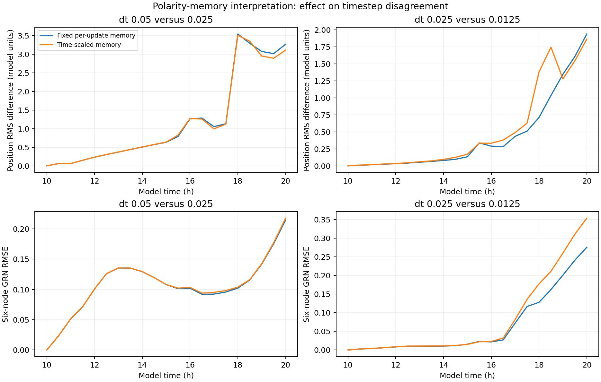

# E008: experimental time scaling of polarity memory

Date: 2026-11-06 (Europe/Berlin). Internal protocol recorded before execution.

## Question and hypothesis

Does rescaling the fixed per-update polarity memory reduce the timestep
sensitivity observed in E007? This tests a candidate contribution to sensitivity;
it does not assume a fix or replace the application model.

## Design

Use the EXACT E007 complete seed-44 hour-10 checkpoint. As in E007, arrest
radius growth/division, zero subsequent GRN noise and observe through hour 20
at half-hour intervals. Test dt=0.05, 0.025 and 0.0125.

Original memory retention m_ref=0.2 is now interpreted relative to the
reference timestep dt_ref=0.05 h. During mechanics use

`m(dt) = m_ref ** (dt / dt_ref)`.

Thus coefficients are 0.2, approximately 0.447214 and 0.668740 respectively.
Two half-step scalar retention factors multiply to one full-step retention
factor. At the reference timestep this is exactly the original coefficient.
The original mechanics then blends polarity and RENORMALIZES the vector.
The scalar identity therefore does not prove exact equivalence of full
directional dynamics at different timesteps or define a validated continuous
time orientation equation. This is an explicit candidate rule interpretation.

The runner temporarily applies the coefficient and restores it after each
mechanics call. No force, neighbor, GRN, pressure, field or application source
rule is otherwise edited. All normal feedback consequences remain active.

## Planned comparisons

Primary: compare per-cell position RMS differences and GRN RMSE between
adjacent timesteps against E007, at the same observation times. Examine
full curves and early/late windows, not only the final marker count.
Secondary: RMS spread, high-SNAIL counts, field RMSE and connectivity.
No statistical test; one starting tissue and three steps are exploratory.

The dt=0.05 arm is a SHAM control: all saved numerical arrays should match
E007 dt005 exactly. Every arm must share the E007 checkpoint digest,
unchanged model-source hashes, fixed IDs/radii, finite observations and
expected update/noise-call counts. Scaled wrapper calls must equal steps.

If differences shrink across most of the timecourse, that supports the
per-update memory interpretation as one contributor. Persistent differences
show it is insufficient on its own. A change that worsens agreement is also
informative. None of these outcomes proves convergence or biological accuracy.

The report also summarizes sampled errors in equal-duration early (10,15]
and late (15,20] model-hour windows. Means weight the ten saved observations
in each window equally; the zero-error shared initial point is excluded.
These descriptive summaries do not replace the full curves.

## Implementation validation

Eight checkpoint/memory tests passed: the five E007 checkpoint/noise tests,
scalar retention composition under step subdivision, exact reference-step
model updates, and coefficient restoration after exceptions. The entire
dt=0.05 sham run was also repeated: all numerical arrays in all 21 saved
observations match E007 exactly, including fields, GRN states and pressures.

Commands from repository root, with fresh output folders:

```powershell
rtk proxy python tools/branching_shared_state.py run --checkpoint research/experiments/2026-11-06-shared-state-timesteps/checkpoint --dt 0.05 --horizon 20 --sample-every 0.5 --polarity-reference-dt 0.05 --output _branching_memory_scaled_dt005
rtk proxy python tools/branching_shared_state.py run --checkpoint research/experiments/2026-11-06-shared-state-timesteps/checkpoint --dt 0.025 --horizon 20 --sample-every 0.5 --polarity-reference-dt 0.05 --output _branching_memory_scaled_dt0025
rtk proxy python tools/branching_shared_state.py run --checkpoint research/experiments/2026-11-06-shared-state-timesteps/checkpoint --dt 0.0125 --horizon 20 --sample-every 0.5 --polarity-reference-dt 0.05 --output _branching_memory_scaled_dt00125
rtk proxy python tools/test_branching_shared_state.py
```

## Implementation notes

The complete checkpoint remains in E007 and is not rewritten. Its canonical
state digest is checked before installing wrappers in every arm. The model
source hashes must match that checkpoint. The optional runner switch defaults
to no scaling, and metadata records reference timestep, reference memory and
actual coefficient used. Scaled calls are counted; a temporary coefficient
is restored even if mechanics raises an exception.

All eight tests also retain the earlier checks for full checkpoint fidelity,
independent state copies and future stochastic equality. The sham's exact
agreement validates behavior at the reference step; it does not validate the
smaller-step variant's biological meaning.

## Results

All arms reached hour 20 with 256 fixed IDs/radii and finite arrays in all
63 observations. All initial arrays match E007's checkpoint exactly.
Scaled-update counts and growth-arrest counts are 200, 400 and 800;
midpoint RNG calls are 51,200, 102,400 and 204,800. No saved cell center
leaves the field. Source hashes remain identical to E007. The reference-step
sham matches all E007 numerical observation arrays exactly.

Final outcomes (original fixed-per-update rule versus candidate scaling):

| dt | Original RMS radius | Scaled RMS radius | Original high-SNAIL | Scaled high-SNAIL |
| --- | --- | --- | --- | --- |
| 0.05 | 3.0524 | 3.0524 | 34 | 34 |
| 0.025 | 2.1869 | 2.2023 | 71 | 72 |
| 0.0125 | 1.5454 | 1.4391 | 23 | 11 |

## Effect on timestep disagreement

The metric is disagreement between two dt arms WITHIN each rule version,
not distance between the original and scaled model at a single dt.
Positive percentage changes below mean MORE disagreement under scaling.

| Adjacent dt pair | Metric | Original early mean | Scaled early mean | Original late mean | Scaled late mean |
| --- | --- | --- | --- | --- | --- |
| 0.05 / 0.025 | Position RMS distance | 0.33156 | 0.33299 | 2.17013 | 2.12691 |
| 0.05 / 0.025 | Six-node GRN RMSE | 0.10000 | 0.10007 | 0.12314 | 0.12485 |
| 0.025 / 0.0125 | Position RMS distance | 0.05442 | 0.06518 | 0.84927 | 0.99758 |
| 0.025 / 0.0125 | Six-node GRN RMSE | 0.00905 | 0.00933 | 0.12707 | 0.16104 |

For the middle/fine pair, early and late mean position disagreements increase
19.76% and 17.46%. Late mean GRN disagreement increases 26.73%. At the
final observation only, position disagreement falls 3.90% (1.93948 to 1.86378),
while GRN disagreement increases 28.28% (0.27590 to 0.35393).

The coarse/middle pair shows a small improvement in late mean position
disagreement (-1.99%) and final position disagreement (-4.85%), with small
increases in GRN disagreement. This mixed evidence would be obscured by
reporting only the final position improvement.



## Interpretation

This specific scalar rescaling does NOT consistently improve timestep
agreement and is insufficient to resolve the observed sensitivity. It does
not establish that all time-based polarity formulations are unhelpful, or
that polarity has no role in the discrepancies. The vector normalization,
state-dependent bias, neighbor geometry, lagged feedback and force integration
remain part of the update scheme.

The application rule is left unchanged. This candidate remains an archived
diagnostic variant, rather than being adopted as a numerical fix. The negative
or mixed result narrows the next question without requiring tuning to obtain
a desired branching outcome.

No numerical convergence, branch formation or biological validity is claimed.
One initial tissue and three timesteps limit generalization. The noise-off,
growth-arrested protocol differs from normal development; improvements or
deteriorations in this protocol do not establish effects in growing noisy
tissues. None of the finest arms is known to be ground truth.

## Next proposed diagnostic (not run)

Freeze regulatory phenotype outputs from the same complete checkpoint, then
compare timesteps while mechanics remains active. This would remove evolving
GRN-to-mechanics feedback as a source of divergence and help distinguish
mechanical-update sensitivity from coupled feedback. Frozen phenotype is an
explicit artificial intervention; it would not represent normal self-organization.
Its exact treatment of polarity bias, chemical inputs and pressure readout
must be described before execution. No application-model change is made here.

## Artifacts and reproduction

dt005, dt0025 and dt00125 preserve the three new runs. analysis contains
within-variant pairwise differences, final summaries, plots and input hashes.
comparison contains before/after error summaries, a figure and provenance.
The complete starting checkpoint remains in E007; no previous experiment
was overwritten. Runner, helper, both report scripts and eight-test source
are copied into this folder. sha256.json hashes local files except itself.

From repository root, reproduce analysis with fresh output folders:

```powershell
rtk proxy python tools/branching_shared_state_report.py research/experiments/2026-11-06-polarity-memory-scaling/dt005 research/experiments/2026-11-06-polarity-memory-scaling/dt0025 research/experiments/2026-11-06-polarity-memory-scaling/dt00125 --output _memory_scaling_analysis_reproduction
rtk proxy python tools/branching_memory_comparison.py --original research/experiments/2026-11-06-shared-state-timesteps/analysis --scaled _memory_scaling_analysis_reproduction --output _memory_scaling_comparison_reproduction
```
