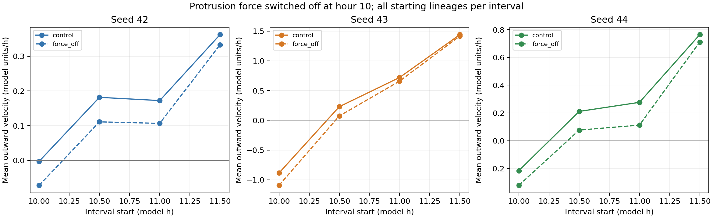

# E004: delayed protrusive-force ablation

Date: 2026-11-06 (Europe/Berlin).

## Protocol recorded before execution

Question: how much of the outward motion between hours 10 and 12 depends
on the active protrusive-force term, rather than the remaining growth and
mechanical processes?

Seeds 42, 43 and 44; dt=0.05 model hours; horizon 12 hours; samples every
0.5 h. Controls are the archived E002 runs. Treatment follows exactly the
same rules until hour 10. On intervals starting at hour 10 or later,
the runner temporarily sets the per-cell protrusion force strength to zero
only during mechanics, restoring the phenotype afterward.

Adhesion, repulsion, polarization, GRN equations, division orientation,
growth and chemical rules are not directly altered. Their subsequent states
may change through feedback. This is a total effect of force suppression,
not a measurement of the isolated instantaneous force contribution.
No model source is edited; the switch exists only in the diagnostic runner.

Primary descriptive comparison: mean outward velocity for starting cell
lineages over matched half-hour intervals. Compare all starting lineages,
not only high-SNAIL cells: treatment may itself alter marker status.
Secondary comparisons: RMS distance from centroid, cell count, connectivity,
elongation, high-SNAIL count and field-boundary excursions at hour 12.

If outward motion falls markedly under treatment, that supports a role for
protrusion in expansion under this protocol. If outward motion persists,
other mechanisms also generate expansion. Neither outcome alone demonstrates
or rules out branching. Seed-wise paired results take precedence over pooling
cells as independent replicates. No significance threshold is prespecified.

Checks: treatment and control snapshots through hour 10 must agree;
exactly 40 mechanics intervals should be treated; source hashes must match.
Random-number streams need not stay aligned after division histories diverge.
Interpretation remains subject to the previous timestep and boundary caveats.

Command:

```powershell
rtk proxy python tools/branching_baseline.py --hours 12 --dt 0.05 --seeds 42 43 44 --sample-every 0.5 --protrusion-off-at 10 --output _branching_protrusion_off10
```

## Results

All runs completed to hour 12. All 63 pretreatment snapshots (21 per seed,
through hour 10 inclusive) matched E002 exactly for every stored array.
Each treatment had exactly 40 ablated mechanics steps. Application model
source hashes match E002. Timing, suppression and restoration on exceptions
were checked separately with a test callback.

Primary summary below gives the arithmetic mean of the four interval means,
so intervals receive equal weight despite changing population size. Outward
velocity is relative to the starting radial direction and corrected for
whole-population centroid drift. It includes expansion and rearrangement;
it does not isolate active motility. Lineage endpoint centroids are weighted
by radius cubed, as in E003. All endpoint cells had identified ancestors.

| Seed | Control mean outward velocity | Force-off mean outward velocity | Off minus control | Relative reduction |
| --- | --- | --- | --- | --- |
| 42 | 0.17838 | 0.11971 | -0.05868 | 32.89% |
| 43 | 0.37580 | 0.26373 | -0.11206 | 29.82% |
| 44 | 0.25922 | 0.14479 | -0.11443 | 44.14% |

Units are model length units per model hour. The first interval contains
mean contraction in some controls and treatments; positive and negative
intervals partly cancel. Relative reductions depend on that aggregation
and must not be interpreted as percentages of expansion caused directly by
the protrusive force. Absolute differences and per-interval results matter.
Every treated interval mean is lower than its corresponding control mean
in this dataset. Different subplot scales below emphasize within-seed pairs.



Secondary observations at hour 12:

| Seed | Cells control / off | RMS radius control / off | High-SNAIL control / off |
| --- | --- | --- | --- |
| 42 | 919 / 913 | 6.4560 / 6.3654 | 17 / 17 |
| 43 | 849 / 834 | 4.6416 / 4.4412 | 73 / 108 |
| 44 | 938 / 936 | 5.0425 / 4.8223 | 24 / 31 |

RMS radius is sqrt(mean squared center distance from the population centroid),
in model length units. Final radius is lower by 1.40%, 4.32% and 4.37%.
Both conditions remain one proximity-connected component at factor 1.25
and have similar elongation, near 1.08-1.14. That is not evidence of branches.
Field-boundary excursions are control/off = 3/2, 0/0 and 0/0 respectively.

## Interpretation

Turning off the force lowers outward movement consistently across these
three matched seeds, supporting a contribution from protrusion to expansion
over this window. Positive net outward movement persists under ablation:
protrusion is not necessary for all expansion under this protocol.

High-SNAIL counts remain unchanged or increase despite no protrusive force.
This reinforces the distinction between regulatory activation and functional
tip behavior. Altered YAP, SNAIL and growth are possible feedback consequences,
not separately manipulated causes. The experiment does not establish which
remaining process is responsible for the residual expansion.

This does not show that protrusion is sufficient for branching, nor that it
is unnecessary at other times. Treatment begins after 10 hours of normal
development, so effects of earlier protrusion remain in both conditions.
Three seeds, one timestep and a two-hour intervention are exploratory;
no inferential statistics or general biological claim is warranted.

## Artifacts and reproduction

The treatment folder preserves settings, all 75 snapshots, CSVs and stop
summaries. trajectories contains per-cell geometry and lineage intervals.
paired_summary.csv and interval_summary.csv preserve the paired descriptive
results. Script copies preserve the exact runner and analysis implementation.
sha256.json hashes archived files except itself. Controls remain in E002;
the control trajectory analysis is E003.

Run the archived analysis scripts from repository root, using fresh output
folders where required:

```powershell
rtk proxy python tools/branching_trajectories.py research/experiments/2026-11-06-protrusion-ablation/treatment --output _ablation_trajectory_reproduction
rtk proxy python tools/branching_ablation_report.py --controls research/experiments/2026-11-06-long-baseline/branching_long_12h_seed42 research/experiments/2026-11-06-long-baseline/branching_long_12h_seeds43_44 --treatment research/experiments/2026-11-06-protrusion-ablation/treatment --control-analysis research/experiments/2026-11-06-trajectory-analysis --treatment-analysis _ablation_trajectory_reproduction --output _ablation_report_reproduction
```

Next candidate experiment: arrest radius growth and division after hour 10
in a separate matched condition to test the contribution of growth to residual
motion. It would change the experimental dynamics and must be explicitly
described before execution. It has not been run.
