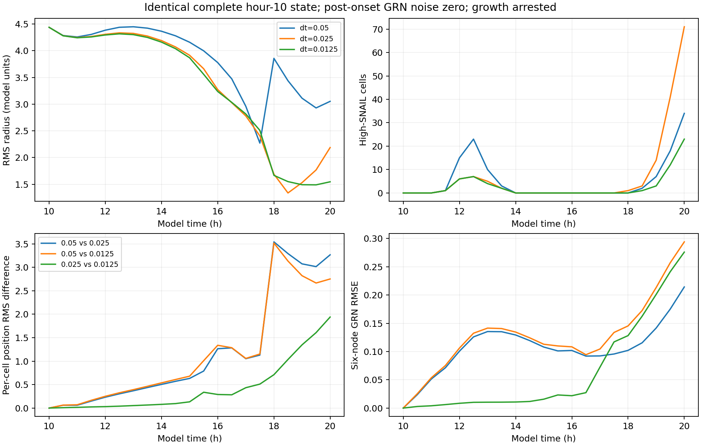

# E007: shared-state deterministic timestep comparison

Date: 2026-11-06 (Europe/Berlin). Internal protocol recorded before execution.

## Question and design

How sensitive are coupled mechanics/GRN dynamics to timestep when COMPLETE
starting state and post-onset random forcing are controlled?

Develop seed 44 normally to hour 10 at dt=0.05, then save the complete state:
every simulation, cell, GRN, field and mechanics attribute, cell ordering,
integer keys, arrays, and PCG64 generator state. Verify exact encode/decode
round-trip, independent array storage and equal future random draws.
Restore that exact checkpoint separately for dt=0.05, 0.025 and 0.0125.
In every arm, arrest radius growth and division and replace GRN random()
with 0.5 so the existing additive noise term is exactly zero. All other
rules remain active. Observe to hour 20 at common half-hour times.
The original stochastic growth-arrested experiment is NOT being reproduced:
zero subsequent GRN noise is an explicit diagnostic intervention.

Primary comparisons at shared times: per-cell position RMS error and GRN
state RMSE against the finest tested arm. Secondary: RMS spread, high-SNAIL
counts, connectivity, chemical-field RMSE and field-boundary excursions.
Also compare the two adjacent timestep pairs. The finest run is a numerical
reference, not established ground truth. Three steps and one starting state
cannot prove global convergence, particularly with discontinuous neighbors
and nonlinear state feedback. No biology is changed to improve branching.

Snapshot provenance must show the SAME complete checkpoint digest for each
arm and identical initial observations. Cell IDs/radii must remain fixed,
all stored arrays finite, and GRN midpoint call counts must equal cell count
times step count. No cell-specific force, GRN or mechanics source edits.

One implementation detail may matter: mechanics blends polarity with a
fixed per-update memory coefficient, and pressure/neighbor signals feed
the GRN on subsequent updates. Changing dt changes those updates per hour.
This test assesses sensitivity of the implemented update scheme; agreement
or disagreement cannot be attributed solely to a conventional ODE solver.

## Checkpoint and implementation checks

The checkpoint stores numeric arrays with dtype and shape; dictionary keys
and ordering; all instance attributes for the simulation, cells, GRNs,
mechanics and chemical fields; and the full PCG64 generator state. A tagged
JSON representation is gzip-compressed. Restoration uses an explicit registry
of the existing model classes rather than reconstructing only selected
diagnostics. There are no experiment wrappers in the saved state: those are
installed separately after each restoration to avoid closures pointing to
the wrong simulation object.

The canonical checkpoint payload SHA256 is
`2c846bb447e3193e79998844de7b19ee15a65557cf132a1369c327f367f30c95`.
The checkpoint's cell positions and IDs match the E006 seed-44 hour-10
observation exactly. All initial arm arrays, including both chemical grids,
are byte-for-byte numerically identical (`array_equal`); complete canonical
state equality is asserted BEFORE installing diagnostic interventions.

Five tests passed: complete encode/decode equality and integer cell keys;
exact equality after a subsequent stochastic model update; isolation of
cell positions, GRNs and both fields; midpoint noise cancellation with
unplanned RNG methods rejected; and unsupported checkpoint types rejected.
Capture also checks nonshared array memory and equal future random draws.

Commands from repository root:

```powershell
rtk proxy python tools/branching_shared_state.py capture --seed 44 --onset 10 --warmup-dt 0.05 --output research/experiments/2026-11-06-shared-state-timesteps/checkpoint
rtk proxy python tools/branching_shared_state.py run --checkpoint research/experiments/2026-11-06-shared-state-timesteps/checkpoint --dt 0.05 --horizon 20 --sample-every 0.5 --output _branching_shared_dt005
rtk proxy python tools/branching_shared_state.py run --checkpoint research/experiments/2026-11-06-shared-state-timesteps/checkpoint --dt 0.025 --horizon 20 --sample-every 0.5 --output _branching_shared_dt0025
rtk proxy python tools/branching_shared_state.py run --checkpoint research/experiments/2026-11-06-shared-state-timesteps/checkpoint --dt 0.0125 --horizon 20 --sample-every 0.5 --output _branching_shared_dt00125
rtk proxy python tools/test_branching_shared_state.py
```

Choose fresh output folders when reproducing; do not overwrite the preserved
checkpoint. The runner rejects source mismatches and checkpoint digest
mismatches. Each arm preserves full chemical grids, selected per-cell arrays,
timecourse CSV, source/runner hashes, checkpoint digest and step/RNG-call
counts. The COMPLETE initial checkpoint is preserved separately; later NPZs
remain observations rather than full checkpoints.

## Results

All arms reached hour 20 within floating-point tolerance, with 256 unchanged
cell IDs and radii. Step counts were 200, 400 and 800; GRN midpoint calls
were 51,200, 102,400 and 204,800, exactly 256 per update. All 63 saved
observations contain finite arrays and no out-of-field cell centers.
All three initial complete-state digests match, source hashes match the
checkpoint, and all initial saved arrays match exactly.

| Timestep (model h) | RMS radius at 20 h | High-SNAIL cells | Mean SNAIL | Components at factor 1.25 |
| --- | --- | --- | --- | --- |
| 0.05 | 3.0524 | 34 | 0.5117 | 5 |
| 0.025 | 2.1869 | 71 | 0.6285 | 1 |
| 0.0125 | 1.5454 | 23 | 0.4357 | 3 |

All start at RMS radius 4.4391. Late contraction/activation differs across
the implemented update timesteps despite identical initial state and zero
subsequent random noise. Mean high-SNAIL counts alone are not a convergence
metric; the continuous states and cell positions were also compared.

### Position differences

RMS Euclidean distance between corresponding cell centers, using fixed IDs
and absolute model coordinates (no rigid alignment or centroid subtraction):

| Time | 0.05 versus 0.025 | 0.025 versus 0.0125 |
| --- | --- | --- |
| 10.5 h | 0.06048 | 0.00866 |
| 12 h | 0.23170 | 0.03059 |
| 14 h | 0.50416 | 0.07884 |
| 16 h | 1.26438 | 0.28932 |
| 18 h | 3.54137 | 0.71105 |
| 20 h | 3.26547 | 1.93948 |

Smaller-step arms agree more closely EARLY, but differences grow markedly
later. At hour 20 the middle/fine position difference is 2.578 mean cell
radii. Their final RMS spreads differ by 0.6414 model units, about 41.5%
of the finest arm's spread (or 29.3% of the middle arm's spread). Neither
denominator is a ground-truth radius.

### Regulatory and field differences at hour 20

| Pair | Six-node GRN RMSE | SNAIL RMSE | Oxygen-grid RMSE | Morphogen-grid RMSE |
| --- | --- | --- | --- | --- |
| 0.05 / 0.025 | 0.21427 | 0.31349 | 0.003887 | 0.002944 |
| 0.05 / 0.0125 | 0.29403 | 0.33670 | 0.005465 | 0.004195 |
| 0.025 / 0.0125 | 0.27590 | 0.35860 | 0.001958 | 0.001527 |

GRN RMSE is the root mean square over cells and six nodes, in order SOX2,
SNAIL, YAP, Notch, cell cycle and HIF1a; SNAIL RMSE uses only that node.
Field RMSE is over all corresponding grid values. Absolute magnitudes
across these different quantities are not directly comparable. Regulatory
errors at hour 20 do not decrease monotonically across adjacent pairs.



## Interpretation

This removes the two major confounds in E006's repeat: different starting
tissues and different future random draws. Substantial timestep sensitivity
persists in the deterministic, growth-arrested coupled update scheme.
Observed late behavior therefore cannot be explained solely by random
realizations or earlier developmental history.

It does NOT establish that the finest arm is converged or biologically
correct, that every difference is an instability, or that a particular node
or force is responsible. This is one starting state. Thresholded neighbors,
lagged pressure/signals, nonlinear feedback, numerical integration and
explicit per-update polarity memory all remain coupled. A fixed per-step
memory coefficient changes its effective time behavior when updates per
hour change, so dt is not currently just a resolution knob.

The early closer agreement is encouraging but does not certify the 20-hour
results. No convergence order was fitted and no acceptable-error threshold
or production timestep is selected from this experiment. Earlier ablation
results remain valid descriptions of their specified update protocol; they
should not yet be presented as timestep-independent physical predictions.

## Next diagnostic proposal (not executed)

Separate the possible sources: first inspect intended physical-time semantics
of polarity memory and update lag, then test mechanics with frozen regulatory
phenotypes from the same checkpoint. A later controlled normalization of
per-update memory would be a model intervention requiring explicit description,
not a silent numerical fix. Additional timestep refinement and starting states
would be needed before claiming general convergence.

## Artifacts and reproduction

checkpoint holds the COMPLETE initial state and provenance. dt005, dt0025
and dt00125 hold the three run observations, timecourses, settings and
completion summaries. analysis contains final summaries, 63 pair/time error
rows (three pairs times 21 observations), a figure and input hashes.
Runner, baseline helper, report and checkpoint test source copies are included;
model sources remain identical to their archived E002 copies. sha256.json
hashes local artifacts except itself. No previous experiment was overwritten.

Rebuild the report from repository root with a fresh output folder:

```powershell
rtk proxy python tools/branching_shared_state_report.py research/experiments/2026-11-06-shared-state-timesteps/dt005 research/experiments/2026-11-06-shared-state-timesteps/dt0025 research/experiments/2026-11-06-shared-state-timesteps/dt00125 --output _shared_state_report_reproduction
```
