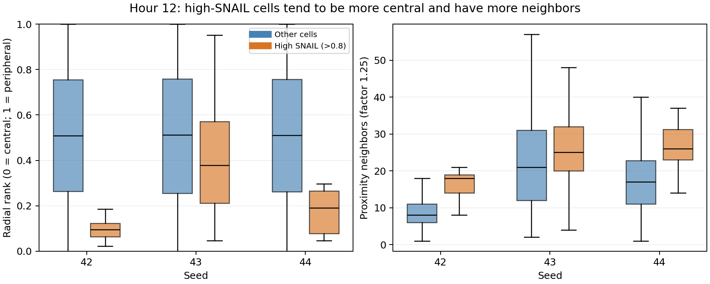

# E003: location and motion of activated cells

Date: 2026-11-06 (Europe/Berlin). Descriptive reanalysis of E002; no new
simulation runs and no changes to the biological or mechanical rules.

## Research question

Are high-SNAIL cells acting like outward-moving, surface-associated leaders
that retain neighboring tissue? This is a hypothesis about function, not
an interpretation guaranteed by the marker name.

## Method

Analyze the three E002 seeds over the saved 10-to-12-hour window.
Geometry groups are classified at each observation using SNAIL > 0.8.
Movement groups are classified at the START of each interval to avoid
selecting movers using their future state. Do not combine those two questions.

Measurements:

- Radial rank: distance from the cell-center centroid ranked within each
  frame, from central (0) to peripheral (1), using midranks for ties.
  This is a global location proxy, not an actual tissue surface detector.
- Proximity neighbors: center separation <= factor times summed radii.
- Local directional imbalance: magnitude of the mean unit direction toward
  proximity neighbors. Zero is directionally balanced, one is one-sided.
  Isolated cells have an undefined value. This proxy is strongly affected
  by neighbor count and is not a validated surface classifier.
- Outward velocity: displacement projected on the START-frame radial
  direction, divided by elapsed time. Subtract whole-population centroid
  drift, but do not subtract tissue expansion.
- When division occurs, use the radius-cubed-weighted centroid of observed
  descendants as the endpoint. This removes symmetric daughter separation
  under equal growth, but unequal growth and rearrangement can still alter
  that centroid. It is not an exact measurement of active migration.
- Neighbor retention: fraction of starting neighbors with an observed
  descendant still in proximity to at least one focal descendant. This is
  contact continuity, not evidence of follower guidance or force transmission.

Observed parent IDs map descendants across intervals. No endpoint cells
were unmatched in this dataset. Longer sampling gaps could miss intermediate
generations; that limitation is recorded in the output rather than ignored.

## Final geometry at hour 12

| Seed | High / other cells | Mean radial rank, high / other | Mean neighbors, high / other |
| --- | --- | --- | --- |
| 42 | 17 / 902 | 0.092 / 0.508 | 16.71 / 8.91 |
| 43 | 73 / 776 | 0.421 / 0.507 | 25.48 / 22.36 |
| 44 | 24 / 914 | 0.199 / 0.508 | 26.33 / 17.33 |

High-SNAIL groups also have lower mean local directional imbalance in all
three seeds. Higher neighbor counts and lower directional imbalance remain
true when reanalyzed at proximity factors 1.0 and 1.5. Radial rank does not
depend on the proximity threshold.



Boxes show medians and interquartile ranges; whiskers use Matplotlib's
default 1.5-IQR convention and outlier markers are omitted. Cells within a
seed are interacting and related by lineage, not independent replicates.

## Forward motion: 11.5 to 12 hours

Only FIVE cells are high-SNAIL at the start of an available forward interval:
three in seed 43 and two in seed 44. Seed 42 has no such intervals. All five
retain high-SNAIL state in their observed endpoints/descendants at 12 h.

| Seed | Start-high / other counts | Mean outward velocity, high / other | Mean retention, high / other |
| --- | --- | --- | --- |
| 43 | 3 / 509 | 1.650 / 1.439 | 0.778 / 0.778 |
| 44 | 2 / 510 | 1.225 / 0.763 | 0.894 / 0.893 |

Velocities are model length units per model hour. Compare groups within the
same interval: pooling earlier intervals would confound state with time.
Four of the five starting high-SNAIL cells divide in this interval.

The high groups move outward and retain many neighbors. Other cells also
move outward and show similar retention. Five cells, some sharing ancestry,
over one half-hour are insufficient to demonstrate persistent leadership.

## Interpretation and next hypothesis

The data support delayed activation preferentially in more central,
neighbor-rich regions at this horizon. They do not establish that SNAIL
causes outward motion, that activated cells are surface tips, or that they
pull followers. The pressure-to-YAP activation rule is a plausible explanation
for internal activation, but has not been isolated experimentally.

Next test should distinguish expansion from active protrusive migration.
A candidate controlled experiment is a matched-seed protrusion ablation,
compared with the unchanged model over the same window. This would test
whether protrusion is necessary for the observed outward motion; it would
not establish sufficiency for branching. No such intervention has been run.
Any intervention must be described and approved before changing cell rules.

## Reproduction and verification

From the repository root:

```powershell
rtk proxy python tools/branching_trajectories.py research/experiments/2026-11-06-long-baseline/branching_long_12h_seed42 research/experiments/2026-11-06-long-baseline/branching_long_12h_seeds43_44 --output _trajectory_reproduction
```

Repeat with --contact-factor 1.0 or 1.5 and fresh output folders for sensitivity.
The sensitivity outputs and their input hashes are archived in this folder.
The analysis source is copied alongside the CSVs. provenance.json hashes the
original E002 input snapshots and the analysis script. No original E002 data
were overwritten.

Checks passed for ancestry mapping (including multiple generations and
unmatched cells), symmetric daughter centroid cancellation, radial ranking
and balanced versus one-sided neighborhood geometry. These validate analysis
operations, not biological correctness. No significance test was performed.
